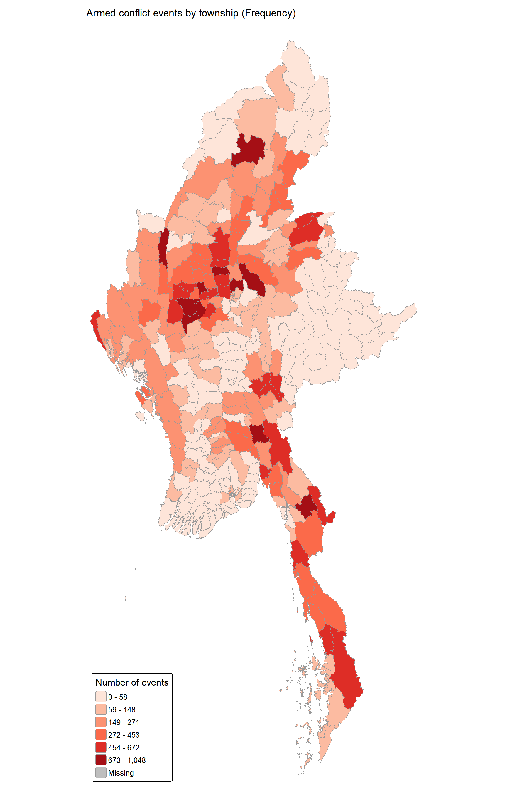
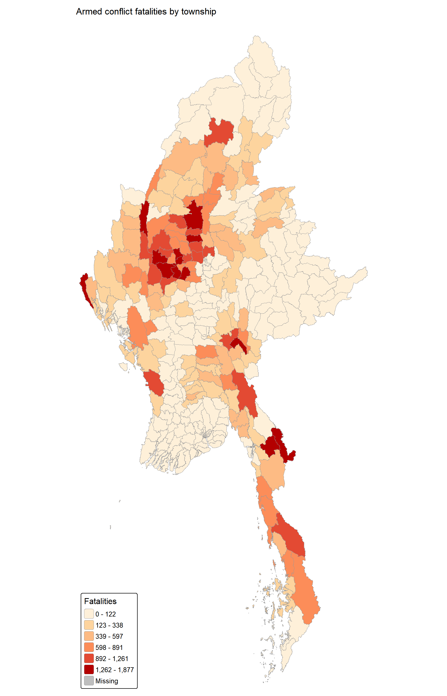
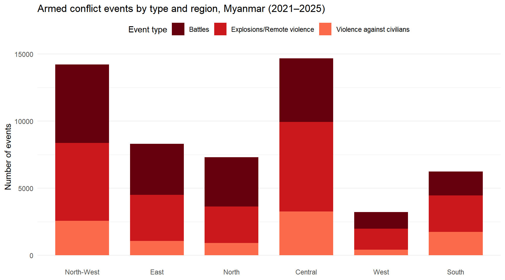
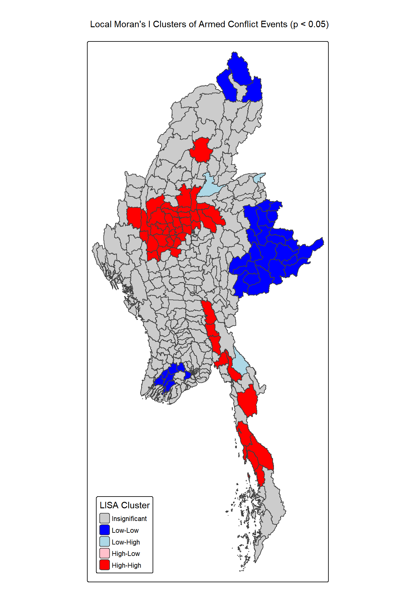
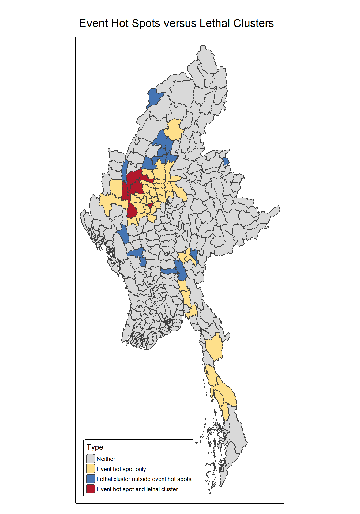
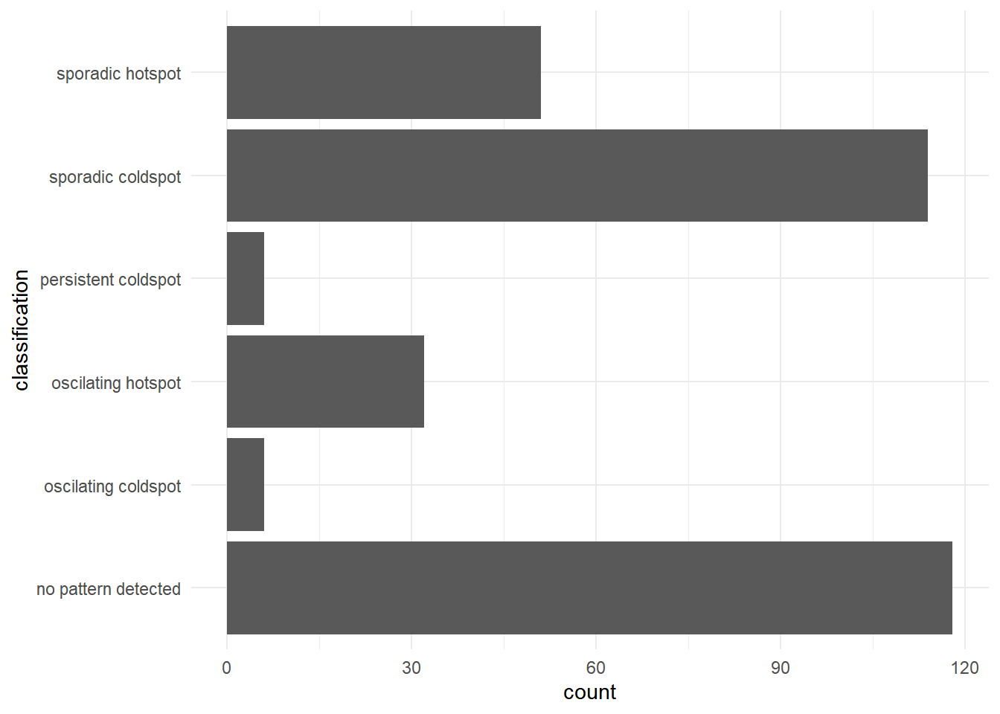
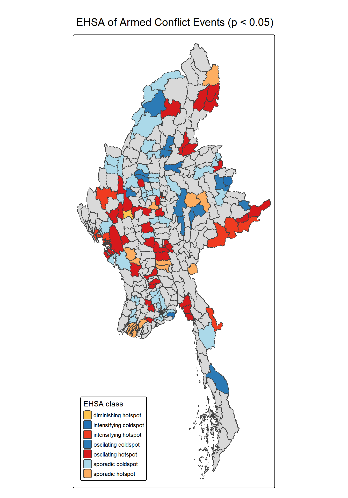

## Research Question

### Context: 

Since the February 2021 military coup, instead of restoring order like many had hoped the Junta's repression followed with brutal crackdowns. This fractured the country into competing zones of control and displacing millions, leaving vast stretches of territory entirely outside the junta's reach.

### Objectives: 

This Take-Home Exercise explores the usage of Local Measures of Spatial Association methods and Emerging Hot Spot Analysis

This is to identify, assess and geovisualizing the spatial distribution, patterns and trends of armed conflict in the Myanmar at township level from **1st January 2021 to 30th September 2025.**

More specifically :

- To pinpoint exact geographic hotspots, cold spots, and spatial outliers where violence clusters or behaves unusually compared to surrounding townships.

- To reveal where, how fast, and in what pattern political violence is evolving over space and time.

This is to assist in the overall objectives on peace-building initiatives and preventing further armed conflicts in the country.

## Study Area and Data

::::: columns
::: {.column width="50%"}
### Study Area:

Myanmar, analyzed at the **Township level** (330 townships).

### Timeframe: 

January 2021 – September 2025 (57 months).

### Data Sources:

**Geospatial:** **Myanmar Township Boundaries (MIMU v9.4)**

- ESRI shapefile format

- WGS 84 geographic coordinate system

**Aspatial:** **Armed Conflict Location & Event Data (ACLED).**

- Records political violence and conflict events across Myanmar from January 2021 to September 2025

- Geographic point coordinate attributes (latitude and longitude in decimal degrees)
:::

::: {.column width="50%"}
### Data Preparation :

**Filtered Events:**

Kept only armed conflict events (Battles, Explosions/Remote Violence, Violence against Civilians), removing protests and riots.

**Point-to-Polygon Join:**

Reassigned 12 unallocated border events to their nearest townships.

**Time Index:**

Created a 1-57 monthly index (`t_idx`) to build the space-time cube.

**Transformation:**

Applied `log1p()` to heavily skewed event/fatality counts for spatial statistics.
:::
:::::

## Analytical Approach

**1. Exploratory Data Analysis (EDA)**

- Spatial Distribution and temporal trends

  - Frequency of Armed Conflicts

  - Fatality of Armed conflicts

- Event type Analysis

  - Regional Distribution of Armed conflict

  - Fatality of Event type

**2. Local Measures of Spatial Association (LMSA)**

- **Local Moran's I:** Identified local spatial autocorrelation and clustering (High-High, Low-Low, Outliers).

- **Getis-Ord Gi**: Identified statistically significant Hot and Cold spots.

- **Empirical Bayes Smoothing**: Calculated true "lethality" (deaths per event) to separate frequent violence from deadly violence.

**3. Emerging Hot Spot Analysis (EHSA)**

- Evaluated 57-month Gi\* time-series for each township using the **Mann-Kendall Trend Test** to classify patterns (Oscillating, Sporadic, Persistent, etc.).

## EDA : Spatial Frequency & Fatalities

:::::::: columns
:::::: {.column width="60%"}
::::: columns
::: {.column width="50%"}
{width="335"}
:::

::: {.column width="50%"}
{width="335"}
:::
:::::
::::::

::: {.column width="40%"}
### Key Findings: 

**Frequency (Left):**

Violence is unevenly distributed and border-anchored.

The primary cluster sits in the north-western area (Sagaing, Magway, Chin), with a secondary cluster along the south-eastern Thai border.

**Fatalities (Right):**

Fatality counts follow the frequency map but show a sharper, more localized concentration. Several townships in the northwest register over 1,200 deaths.

**Temporal Trend:**

Across the 57 months, the event frequency escalates significantly.

It shifts from isolated border activity in early 2021 to widespread, sustained intensity by 2025, with the South evolving into a continuous high-intensity corridor.
:::
::::::::

## EDA : Event Type Analysis

::::: columns
::: {.column width="50%"}
{width="540"}
:::

::: {.column width="50%"}
{width="601"}
:::
:::::

### Key Event Type Findings:

**Regional Breakdown (Left):**

The Central and North-West regions dominate total event counts.

- In the Central region, violence is heavily driven by *explosions and remote violence* (airstrikes/shelling) alongside the highest national occurrence of *violence against civilians*.

- The North-West is driven by *direct battles*.

**Temporal Breakdown (Right):**

- Direct battles (dark red) consistently account for over 60% of yearly fatalities.

- Total annual death tolls doubled from \~11,000 in 2021 to over 24,000 in 2022, remaining high through 2024 before the partial-year drop in 2025.

## LMSA : Frequency & Spatial Clusters

::::: columns
::: {.column width="50%"}
{width="420"}
:::

::: {.column width="50%"}
### Key Findings:

**High-High Clusters:**

Conflict forms contiguous regional blocks. Two main belts: Central-Northwest (Sagaing-Magway-Mandalay) and South-East (Kayin/Mon).

**Low-Low Clusters:**

Persistently quiet areas (e.g., eastern Shan, northern Kachin).

**Statistic:**

Global Moran's I = 0.676 (p \< 2.2e-16), confirming strong spatial clustering.

**Gi\* vs LISA:**

Both statistics agree on the core clusters, making the findings highly robust.
:::
:::::

## LMSA : Lethality (The "Deadly" Clusters)

::::: columns
::: {.column width="50%"}
{width="413"}
:::

::: {.column width="50%"}
### Key Findings:

**Empirical Bayes Smoothing** was applied to remove small-number noise from townships with very few events.

Only **12%** of event hot spots are also "lethal clusters" (red) in the central-northwest. *Violence here is unusually deadly per incident,* so peacekeeping interventions should be prioritized at all cost in these hotspots.

**43 townships** are busy but less deadly per incident (yellow), mostly in the south-east. Their high fatalities are driven by volume, not lethality.

**15 townships** (blue) are lethal clusters *outside* main event hot spots, showing deadly spillover effects.
:::
:::::

## EHSA : Temporal Trends & Mann-Kendall

::::: columns
::: {.column width="50%"}
### Trend Analysis

Applied the **Mann-Kendall test** to each township's 57-month Gi\* time series.

- **H0:** No monotonic trend.

- **H1:** Monotonic trend present.

Rejected H0 (p \< 0.05) for 190 townships, proving systematic escalation or de-escalation.

**Top Escalating Townships (Positive Tau, p = 0):**

- **Bago Region** dominates the list (Taungoo, Kyauktaga, Letpadan).

- **Other top townships**: Magway, Mandalay, Tanintharyi.
:::

::: {.column width="50%"}
{width="869"}
:::
:::::

## EHSA : Emerging Hot Spot Map

::::: columns
::: {.column width="50%"}
{width="434"}
:::

::: {.column width="50%"}
### Key Findings:

**Dynamic landscape:**

Static "persistent" hot spots barely exist. Conflict is dominated by **Oscillating** and **Sporadic** hot spots.

**Expanding Frontlines:**

Bright red (Intensifying) and Oscillating hot spots stretch from Sagaing down to Kayin/Mon. These areas repeatedly flipped between extreme conflict and relative calm.

**Bago is expanding:**

Sporadic hot spots (light orange) are appearing in previously quieter central areas, meaning response planning must remain highly mobile.
:::
:::::

## Limitations & Public-Safety Implications

::::: columns
::: {.column width="50%"}
### Limitations

**Data Blind Spots:**

The analysis assumes that the ACLED data accurately reflects the true number of events and fatalities.

However there is the possibility of a number armed conflict events to be self reported. Active war zones with restricted access may suffer under-reporting. A "cold spot" may actually be a "data blind spot." rather than a truly peaceful township.

**MAUP:**

Analysis relies on fixed township boundaries. So several insights may be missed since spatial clusters may look different if the data was aggregated at a different scale.

Conflict often also follows geography (rivers, mountains), not administrative lines, so clusters are artificially cut off at borders

**Parameters:**

The analysis assumes that spatial dependence exists only between townships that share a boundary in Queen Contiguity, but conflict can easily spill over to further regions or towns which are misses from events like long-range airstrikes.

The EHSA `k=2` window smooths data, hence potentially missing sharp 1-month flare-ups. Furthermore, a different k value would yield a different set of classifications as well.
:::

::: {.column width="50%"}
### Public-Safety Implications:

**Priority 1 (Sagaing & Magway):**

These are both frequent *and* deadly. They require immediate, high-level diplomatic and humanitarian intervention for civilian protection.

**Priority 2 (Bago):**

Statistical trends show Bago is rapidly transitioning into a major front. Early warning systems must be deployed immediately.

**Agile Corridors:**

The South and East are highly volatile. Peacekeepers must use mobile, rapid-response frameworks rather than permanent bases.
:::
:::::
